<div align="center">


# Kitbash

**Pick a game, pick mods, press Launch.**

A mod launcher for Windows. It puts the mod loader and the mods into the game folder,
starts the game through Steam, and when you close the game the folder is exactly as it
was before. Settings and saved data of every mod stay in the launcher and come back
on the next launch. In the game, one key shows which mods loaded and how to use them.

[](https://github.com/ImKirit/Kitbash/releases/latest)
[](LICENSE)
[](#install)

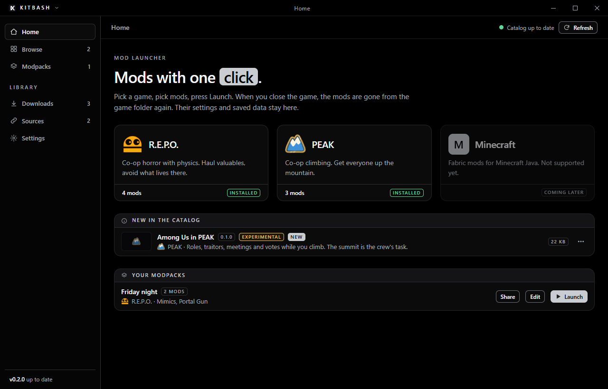

</div>

---

## Why?

I build mods that drop a piece of one game into another, and I wanted my friends to
play them without a lesson in mod loaders, plugin folders and "which DLL goes where".
Most of these mods also need everyone in the lobby to run the same version.

The one decision behind Kitbash: **your game folder is borrowed, not changed.** A mod
loader you installed yourself, with your own plugins and settings, is moved aside for
the session and put back byte for byte afterwards. If the launcher or the PC dies in
between, the next start finishes the clean-up from a journal.

## Getting started

1. **Install** the [latest release](https://github.com/ImKirit/Kitbash/releases/latest) and
   start it. `Browse` in the sidebar shows every game of the catalog with its own icon, and
   whether Steam has it installed on this PC. The search finds games and mods.

   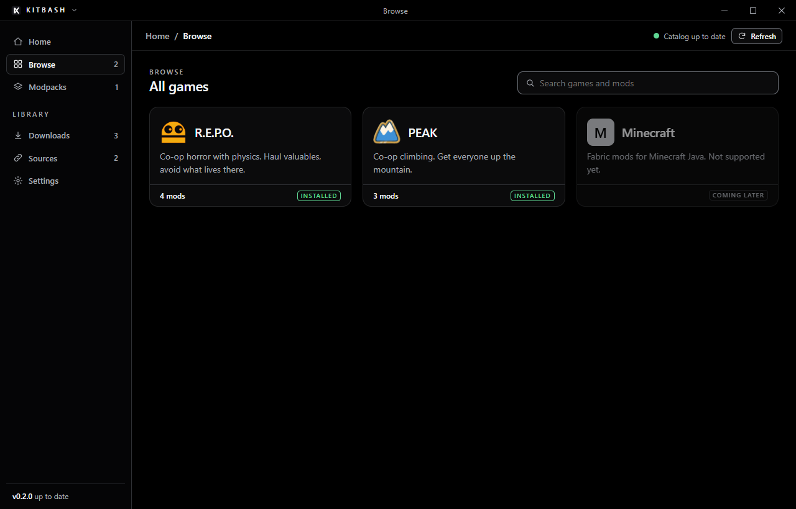

2. **Open a game and tick the mods you want.** The bar at the bottom shows what is still
   to download and tells you if something is missing or two mods do not go together.

   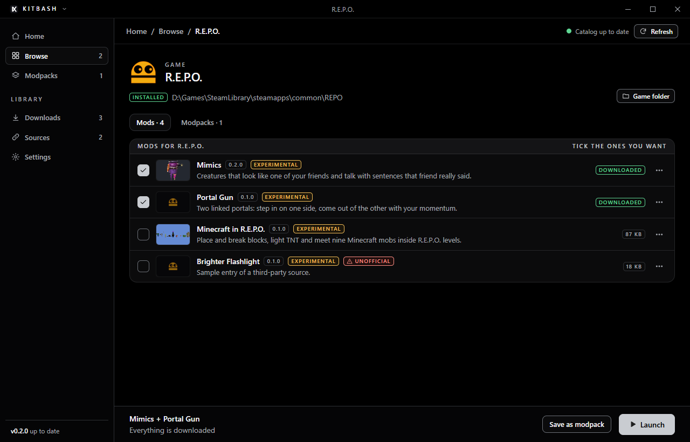

3. **Read the mod page once.** `You need` is checked on your PC (the game, Minecraft Java,
   another Steam game). `You should know` says what the mod expects from a lobby and how
   far it has been tested.

   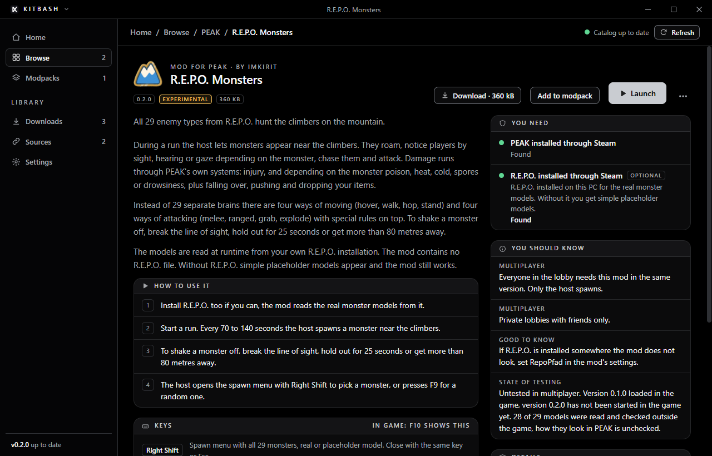

4. **Press `Launch`.** The launcher downloads what is missing, sets up loader, mods and your
   saved data, and starts the game through Steam. You can close the window, it stays in the
   tray.

   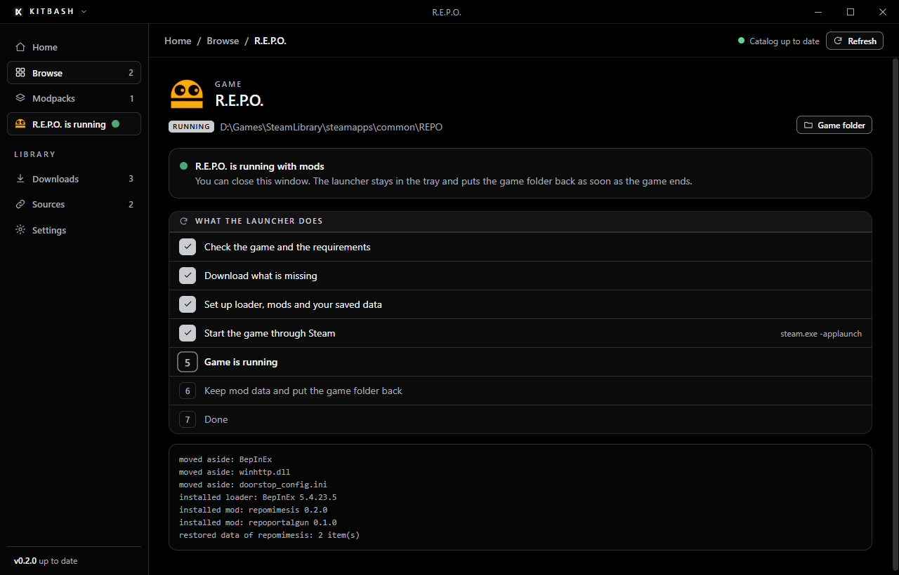

5. **Press `F10` in the game** to see which mods loaded and how each one is used. Click a
   mod for its keys and steps.

6. **Close the game.** Mod data is kept, everything else is removed and your own files are
   back in place.

   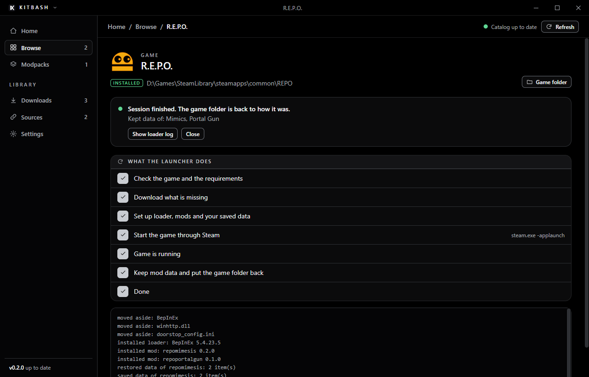

7. **Optional:** save your selection as a modpack and send the code to your friends, so
   everyone launches the same set with one click.

## Features

### Launch

- **One click per session.** Finds Steam through the registry and the game through
  `libraryfolders.vdf` and its app manifest. Starts with `steam.exe -applaunch`, falls back
  to the `steam://` link and then to the game exe, and checks that the process really appeared.
- **Several mods at once.** Tick any mods of the same game. Conflicts, the minimum launcher
  version and every requirement are checked for the whole set before anything is touched.
- **Requirements that are checked, not just listed.** A Steam game being installed and
  Minecraft Java (with a minimum version) are looked up on your PC. Required ones block the
  launch, optional ones are shown as such.
- **Refuses what it should not touch.** Games with anti-cheat, a game that is already
  running, an IL2CPP build for a Mono loader.

### In the game

- **Overlay on `F10`.** A small BepInEx plugin that the launcher installs with every launch and
  removes afterwards. It lists the mods of the session, whether BepInEx loaded each one and
  which errors they logged. Clicking a mod shows its description, its keys and the steps to use
  it. It is drawn inside the game, so it also works in exclusive fullscreen. The key can be
  changed or the overlay switched off in the settings.
- **How to use it, also in the launcher.** Every mod page shows the same keys and steps, plus
  real screenshots from the game.

### Keep your things

- **Your own mod setup survives.** A loader or plugins the launcher did not install are moved
  to `.kitbash-aside` inside the game folder for the session and restored afterwards.
- **Mod data stays.** Each mod names the files that hold its settings and saved data. They are
  copied into the launcher after the game and put back before the next one, per mod and per game.
- **Crash safe.** A journal is written before the first change. After a crash or a power cut the
  next start completes the clean-up, once the game is no longer running.
- **Import from a manual install.** If a game folder already holds data of a known mod, the
  launcher offers to copy it. Nothing in the game folder is removed.

### Find and share

- **Catalog that updates itself.** The mod list is fetched on start and every 30 minutes and
  kept for offline use. New and updated mods are marked.
- **Downloads only when needed.** A package is fetched when you press `Download`, add the mod to
  a modpack or launch it. The `Downloads` view shows what is on disk and removes it again.
- **Modpacks.** Named sets of mods per game, launched with one click. A pack exports to a short
  text code (`KB1-...`) that lists mods, versions and sources.
- **Other people's catalogs.** Add a GitHub repository or a catalog URL under `Sources`. Its mods
  are marked `Unofficial` wherever they appear, and you confirm a plain warning when adding the
  source and again before its first download.
- **Game icons from your own install.** Each game shows the icon of its installed exe, read on your PC and cached. Nothing is bundled.
- **Black and silver**, own title bar, German and English. The light theme stays in the settings.
- **Menus where they help.** Every mod row and mod page has a menu (download, add to a modpack,
  launch alone, game folder, loader log), and the name in the title bar opens the app menu.
- **Updates itself** from GitHub releases: checked on start and every four hours, downloaded in
  the background, installed when you quit.

## Screens

| Mod page | How to use a mod |
|---|---|
| 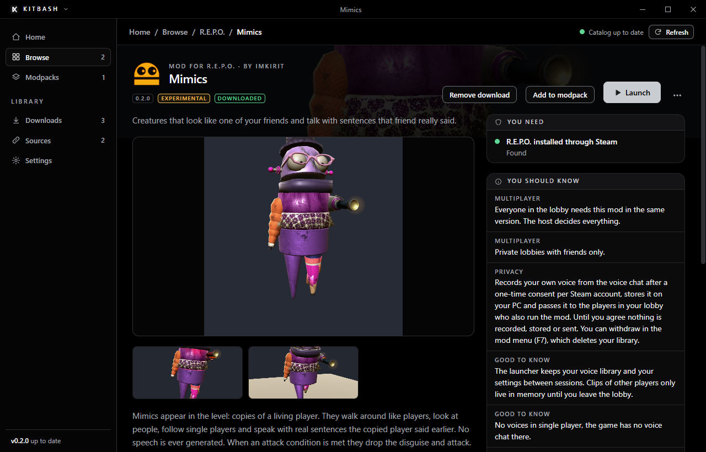 |  |
| **Mods of a game, with a menu** | **Modpacks** |
| 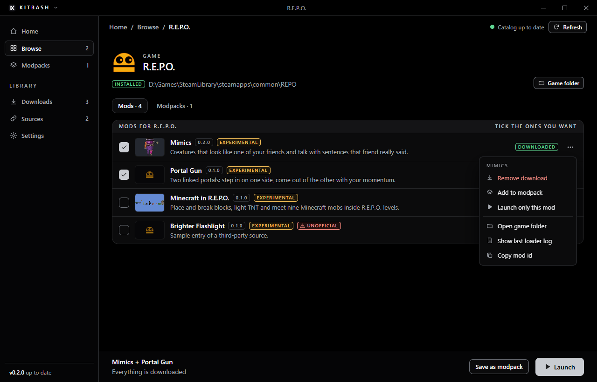 | 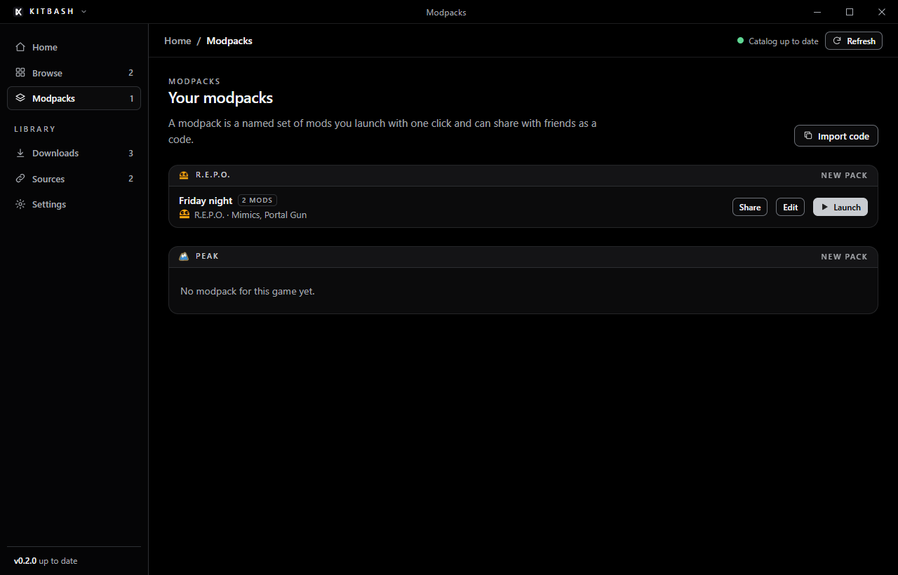 |
| **Downloads** | **Sources** |
| 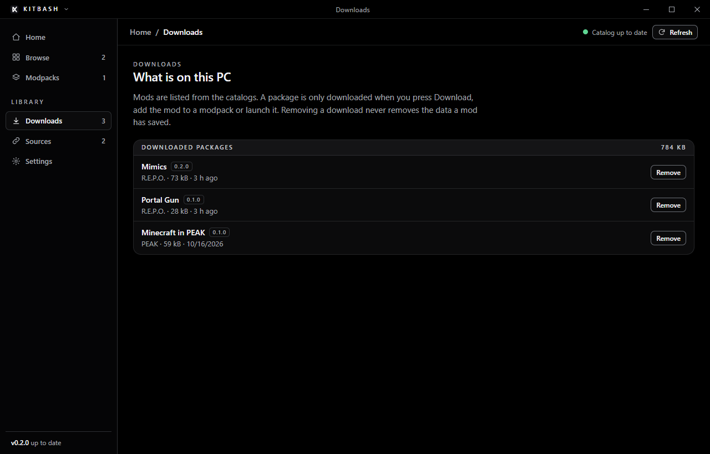 | 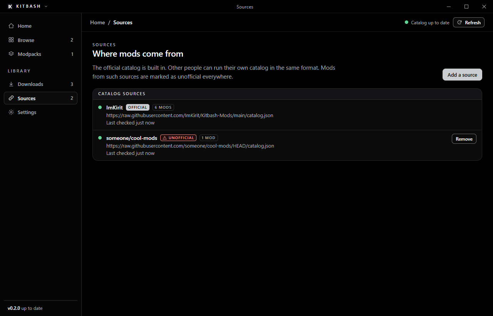 |
| **Warning for unofficial sources** | **Light theme, German** |
| 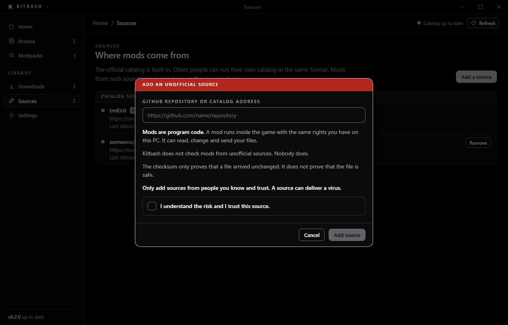 | 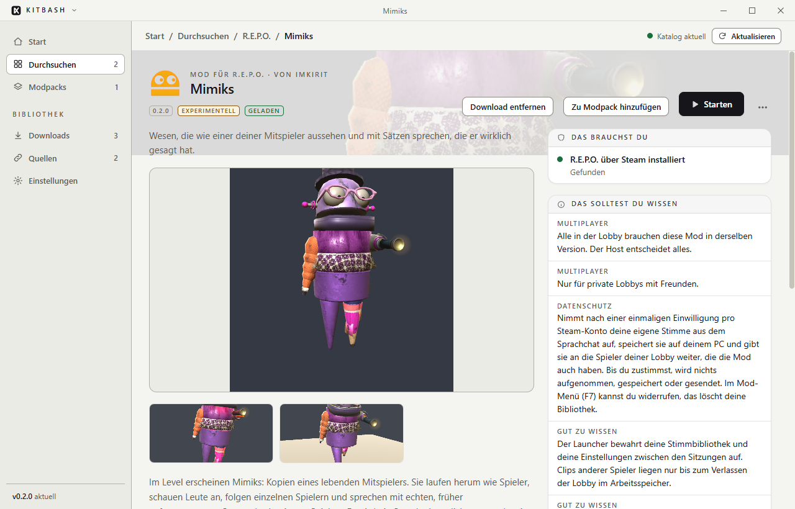 |

## Safety

A mod is program code that runs inside the game with your rights. The launcher cannot make a
mod safe. What it does guarantee:

| Rule | What it means |
|---|---|
| HTTPS only | Catalogs, packages and the loader are never fetched over plain HTTP. |
| SHA256 for every file | A download that does not match the catalog is thrown away. A checksum proves the file is unchanged, not that it is harmless. |
| Loader from one place | The mod loader comes from the official download address and hash built into the launcher. No catalog can change that. |
| Packages stay with their catalog | A package must sit next to its catalog, on the same host, or on GitHub inside the same repository. |
| No shadowing | Mods of an unofficial source get their own id space. They cannot replace a mod or a game of the official catalog. |
| Mods only go into mod folders | For BepInEx that is `BepInEx/plugins` and `BepInEx/patchers`. An archive that reaches anywhere else is refused, including `..` tricks. |
| Nothing from a catalog is executed | The launcher places files. It never runs them. |
| Only the journal decides what is removed | A path that is not claimed in the journal is never deleted. |

Mods in the official catalog are marked `Experimental` where they have not been played in a
real lobby yet. The mod page says exactly what has been tested.

## How data is stored

```
%APPDATA%\Kitbash\data\
  settings.json            language, theme, added sources
  packs.json               your modpacks
  catalogs\<source>.json   last good copy of each catalog
  cache\loaders\           mod loader archives, named by SHA256
  cache\mods\<source>\     downloaded mod packages, named by SHA256
  cache\images\<source>\   pictures from the catalogs
  store\<game>\<mod>\      settings and saved data of each mod
  sessions\<game>.json     journal of a running session, gone when it is cleaned up
  logs\<game>\             the loader log of the last session
```

## Install

**[Download the latest release](https://github.com/ImKirit/Kitbash/releases/latest)** and run the
installer. Windows 10 or 11, Steam, and the games you want to mod.

From source:

```
git clone https://github.com/ImKirit/Kitbash.git
cd Kitbash
npm install
npm start
```

## Development

```
npm start              # run the app against the official catalog
npm run dev            # run against a catalog in ../Kitbash-Mods
npm test               # engine, sources and modpack tests (node:test)
npm run screenshots    # render every screen into docs/
npm run icon           # redraw build/icon.png and icon.ico
node scripts/build-overlay.js --refs <folder>   # rebuild the in-game overlay (needs the .NET 8 SDK)
npm run dist           # build the Windows installer into dist/
npm run cli -- list    # the engine without the window: list, check, launch, import, recover
npm run publish-mod -- <modDir> --files <folder>   # add a mod to a local catalog copy
```

Plain Electron without a build step and with one runtime dependency (`electron-updater`).
`src/main` holds the engine (`engine.js`, `sources.js`, `session.js`), which runs without
Electron and is what the tests exercise against fake game folders. `src/renderer` is one page
of plain HTML, CSS and JavaScript, and `demo.js` stands in for the preload API when the
screenshots are taken. Product name, app id and repository names live in `src/brand.js`.
`overlay/` is the C# source of the in-game overlay, its built DLL ships in `src/assets/`.

The catalog format is documented in the
[Kitbash-Mods](https://github.com/ImKirit/Kitbash-Mods) repository.

## License

[MIT](LICENSE) © ImKirit. BepInEx is downloaded from its own releases and is licensed
under LGPL-2.1.
